# NOTE 1: KiCad Basic

## 1. Pendahuluan
Cakupan Catatan:
- Pembuatan Project Baru
- Penyusunan Skematik
- Pengecekan Kelaikan Kelistrikan (ERC)
- Pemetaan *Footprint*
- Tata Letak Layout PCB
- Routing
- Pengujian Aturan Desain (DRC)
- Visualisasi 3D

### 1.1 Tabel Acuan *Shortcut* Dasar KiCad

| Fitur / Tindakan | Shortcut Keyboard | Modul |
| --- | --- | --- |
| Project Baru | `Ctrl + N` | KiCad Manager |
| Tambah Symbol | `A` | Schematic Editor |
| Tambah Power Symbol | `P` | Schematic Editor |
| Edit Properties / Values | `E` | Schematic & PCB Editor |
| Update PCB dari Skematik | `F8` | Schematic / PCB Editor |
| Tambah Track / Trace | `X` | PCB Editor |
| Tambah Via | `V` | PCB Editor |
| Zona Tembaga (*Filled Zone*) | `Ctrl + Shift + Z` | PCB Editor |
| Re-fill All Zones | `B` | PCB Editor |
| Tampilan 3D Viewer | `Alt + 3` | PCB Editor |

---

## 2. Membuat Project Baru pada Menu Awal

### 2.1 Membuka Menu Utama & Membuat Project Baru

1. Buka aplikasi **KiCad**.

2. Pada jendela utama KiCad Project Manager, klik tab **File** > pilih **New Project...** atau gunakan kombinasi tombol pintas `Ctrl + N`.

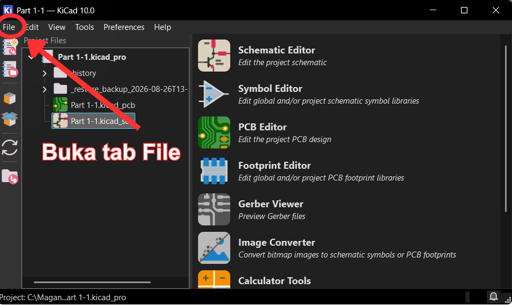

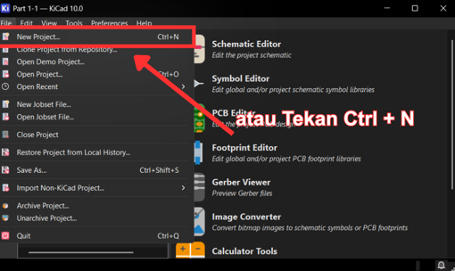

### 2.2 Pemilihan Template Project

1. Jika jendela *Project Template Selector* muncul, pilih opsi **default** (*Default KiCad project template*).
2. Opsi ini akan menyediakan konfigurasi layer dan aturan standar bawaan KiCad.
3. Klik tombol **OK** untuk melanjutkan.

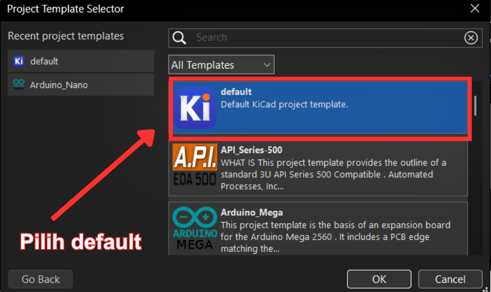

### 2.3 Menentukan Direktori Penyimpanan Project

1. Pilih direktori/folder kerja di dalam komputer tempat Anda ingin menyimpan file project.
2. Pastikan centang opsi **"Create a new folder for the project"** aktif agar seluruh file sistem (`.kicad_pro`, `.kicad_sch`, `.kicad_pcb`) terorganisir dengan baik.
3. Beri nama file project (contoh: `Part 1-1`) lalu klik **Save**.

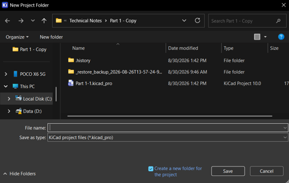

---

## 3. Menyusun Skematik Rangkaian (*Schematic Editor*)

### 3.1 Membuka Schematic Editor

Dari halaman utama KiCad Project Manager, klik dua kali pada file berekstensi `.kicad_sch` atau klik pada ikon **Schematic Editor** pada panel sebelah kanan.

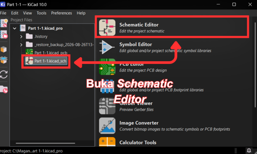

### 3.2 Menambahkan Symbol Komponen

1. Klik ikon **Add Symbol** pada toolbar sebelah kanan atau tekan shortcut `A` pada keyboard.

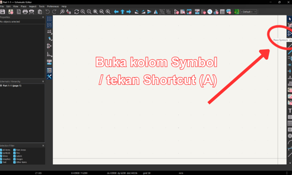

2. Pada jendela *Choose Symbol*, ketikkan nama komponen yang dibutuhkan pada kolom pencarian, sebagai contoh "LM317":

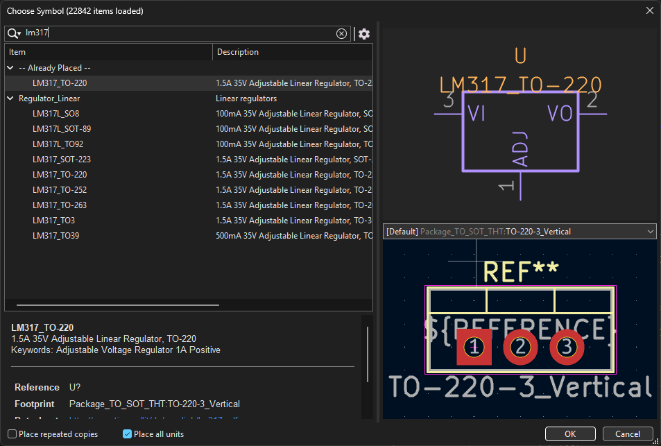

3. Pilih symbol yang sesuai, lalu klik **OK** dan tempatkan pada lembar kerja skematik.

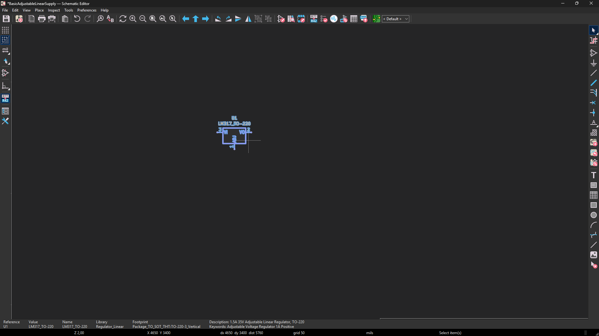

### 3.3 Penambahan Power Symbol, Ground, dan Power Flag

1. Tekan tombol `P` pada keyboard atau klik ikon **Add Power Port** pada toolbar kanan untuk membuka jendela *Choose Power Symbol*.
2. Pilih symbol `VCC` / `+5V` untuk masukan tegangan positif dan `GND` untuk jalur nol/referensi bumi.
3. **Penting:** Tambahkan komponen `PWR_FLAG` pada rel `VCC` dan `GND`. Ini bertujuan memberi tahu sistem ERC KiCad bahwa jalur suplai tersebut mendapatkan pasokan daya eksternal secara sah.

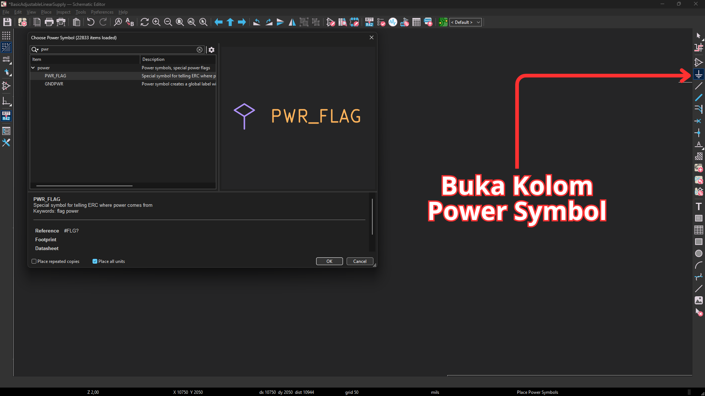

### 3.4 Menangani Pin yang Tidak Terhubung (*No Connection*)

Untuk komponen yang memiliki pin yang tidak digunakan, pasang simbol **No Connection Flag** (shortcut `Q` atau ikon silang `X`). Hal ini mencegah sistem ERC mendeteksi pin gantung sebagai kesalahan pengkabelan.

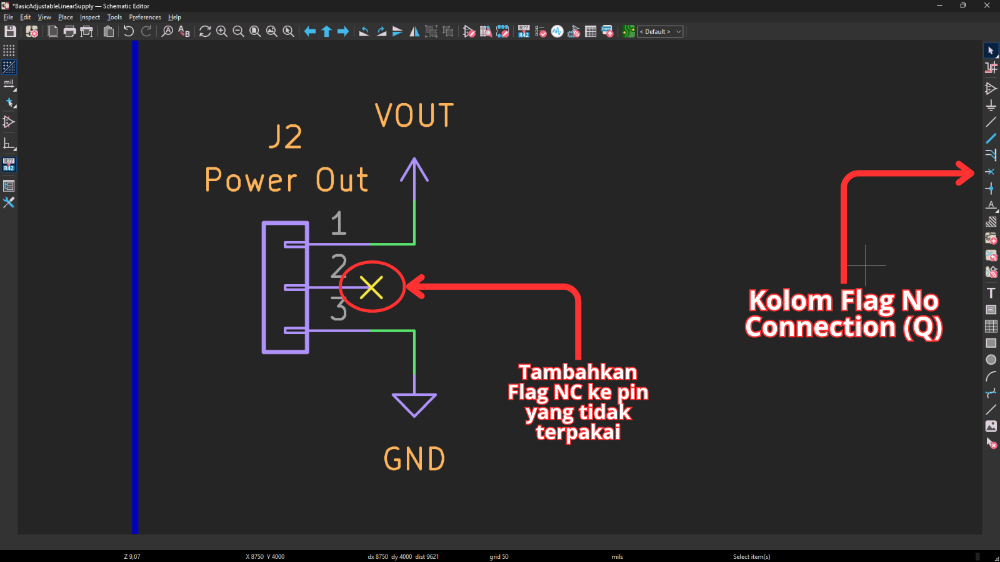

### 3.5 Registrasi dan Pemetaan Footprint (*Symbol Fields / Footprint Assignment*)

Setiap symbol pada skematik harus diasosiasikan dengan bentuk fisik paket komponen (*footprint*):

1. Buka tab **Edit Symbol Fields** (ikon tabel pada toolbar atas).

2. Periksa kolom *Footprint* untuk setiap komponen.

3. Apabila terdapat komponen yang belum memiliki *footprint* terdaftar, klik pada kolom tersebut lalu pilih *footprint* yang sesuai melalui *Footprint Library Browser* (Contoh: `Resistor_THT:R_Axial_DIN0207_L6.3mm_D2.5mm_P10.16mm_Horizontal` untuk resistor 1/4W THT).

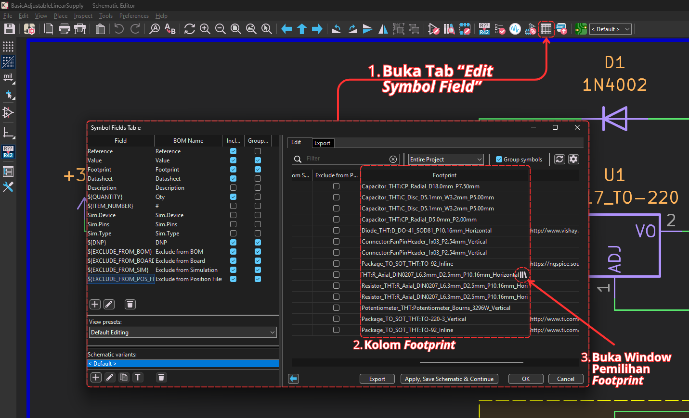

Cari footprint yang sesuai pada *Footprint Library Browser*.

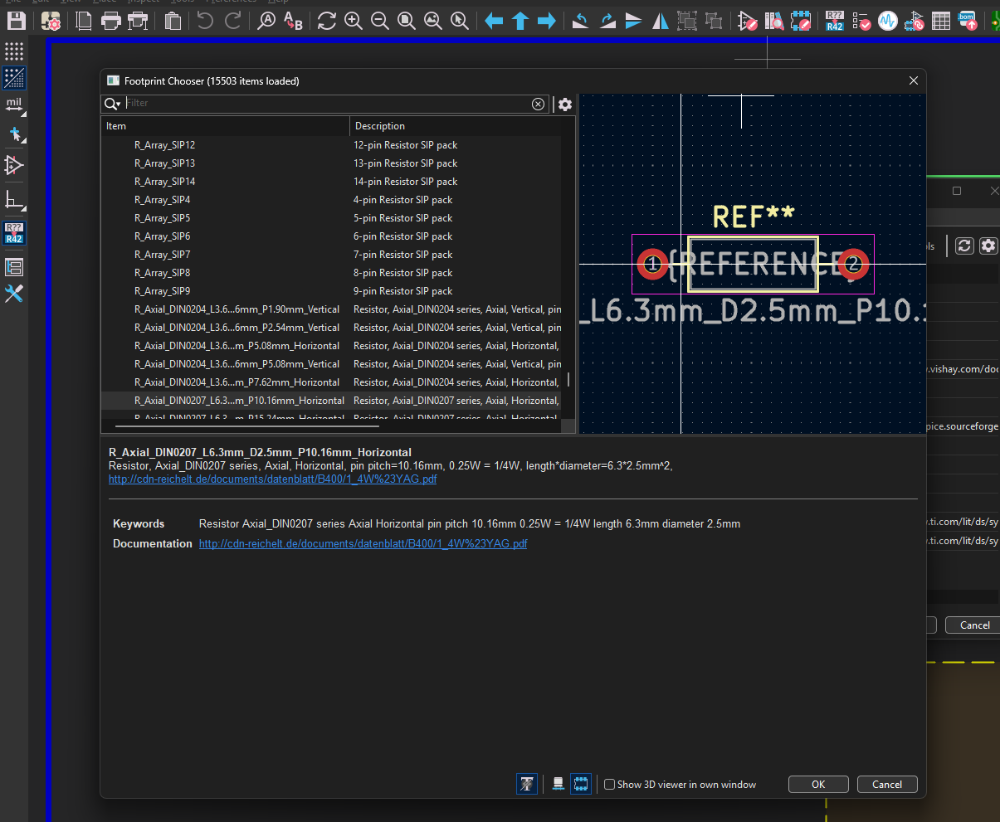

### 3.6 Anotasi Skematik & Electrical Rules Checker (ERC)

1. **Anotasi Skematik:** Klik ikon **Annotate Schematic** (ikon `R??` -> `R42`). Klik tombol **Annotate** untuk memberikan nomor indeks unik pada setiap komponen (misal: R1, R2, U1, C1).

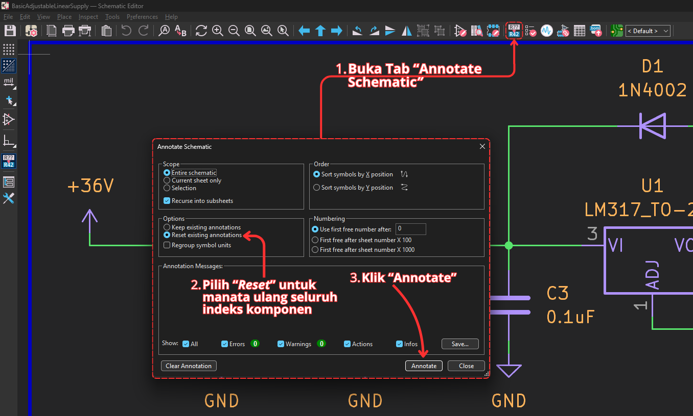

2. **Pengecekan ERC:** Klik ikon **Electrical Rules Checker** (ikon centang hijau/merah). Klik **Run ERC** untuk memverifikasi keabsahan sistem kelistrikan skematik. Pastikan tidak ada pesan *Error* sebelum melangkah ke tahap layout PCB.

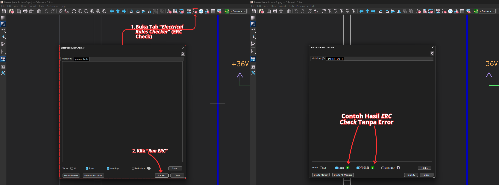

---

## 4. Menyusun Rangkaian PCB (*PCB Editor*)

### 4.1 Sinkronisasi Skematik ke PCB Editor

1. Buka modul **PCB Editor** langsung dari KiCad Manager atau dengan menekan tombol **`F8`** dari jendela Schematic Editor.

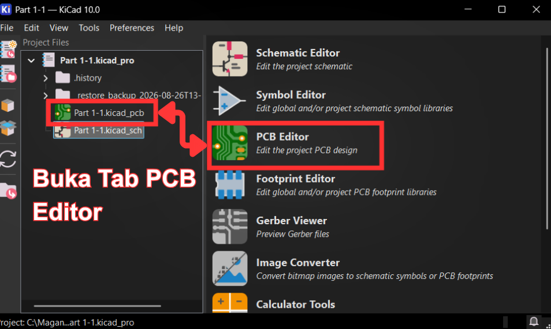

2. Pada jendela *Update PCB from Schematic*, klik tombol **Update PCB**.

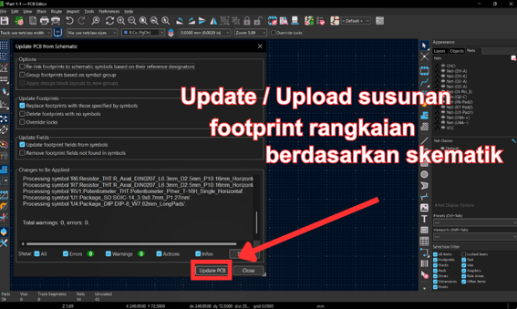

3. Seluruh *footprint* beserta garis petunjuk koneksi (*Ratsnest / Netlist lines*) akan diimpor ke dalam lembar kerja PCB.

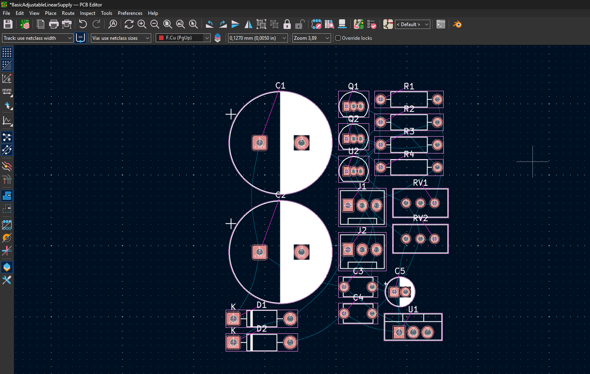

### 4.2 Tata Letak & Penyusunan Komponen (*Placement & Alignment*)

1. Pindahkan komponen satu per satu dengan menekan tombol `M` (*Move*) atau putar dengan tombol `R` (*Rotate*).

2. Susun komponen secara rapi dan logis. Perhatikan garis samar biru (*Ratsnest*); posisikan komponen agar garis interkoneksi saling bertumpukan seminimal mungkin untuk mempermudah alur *routing*.

### 4.3 Pembuatan Zona Tembaga / Ground Plane (`F.Cu` / `B.Cu`)

Area *Copper Pour* / Zona Ground berguna untuk meningkatkan stabilitas daya sistem dan meredam *noise*:

1. Tekan shortcut `Ctrl + Shift + Z` atau klik ikon **Add a filled zone** pada toolbar kanan.

2. Pilih layer target (misal: `F.Cu` untuk Front Copper).

3. Pada opsi *Net*, pilih **GND**. Klik **OK**.

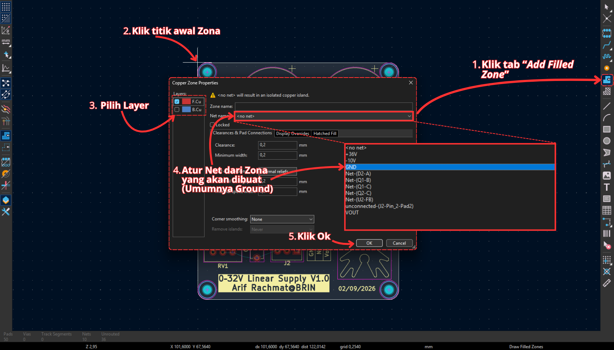

4. Klik pada 4 sudut mengelilingi rangkaian untuk membentuk poligon zona.

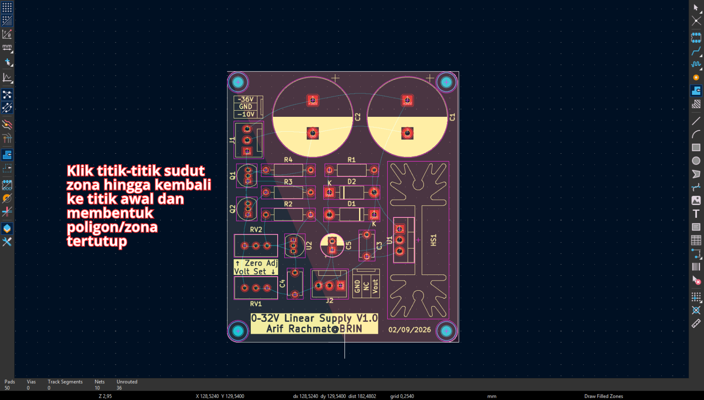

5. Tekan tombol **`B`** untuk memicu proses pengisian zona (*Re-fill Zone*).

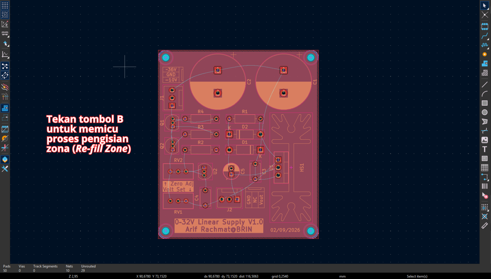

### 4.4 Penentuan Batas Potong Papan (*Board Outline / Edge.Cuts*)

1. Pilih opsi layer **Edge.Cuts** pada panel layer sebelah kanan.

2. Pilih alat menggambar persegi (**Draw Rectangle**) atau garis (**Draw Line**).

3. Buat batas luar fisik papan PCB mengelilingi zona rangkaian.

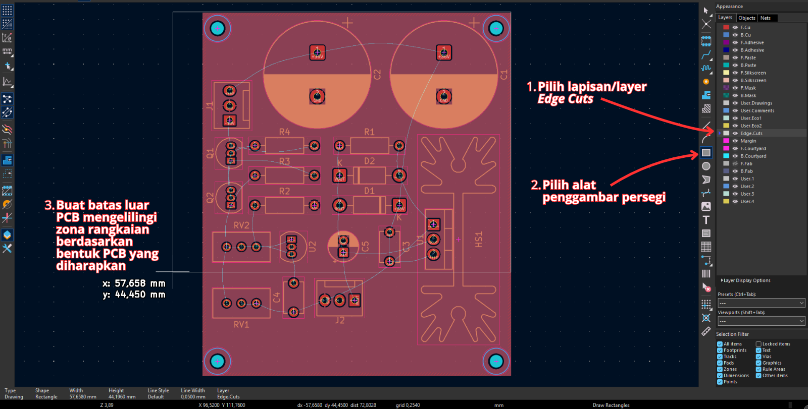

4. **Memberi Sudut Melingkar (*Corner Fillet*):** Pilih bentuk persegi tersebut, tekan `E` (*Properties*), pada opsi *Corner Radius* isi nilai radius yang diinginkan (misal: `2.0 mm`) agar sudut fisik papan tidak tajam.

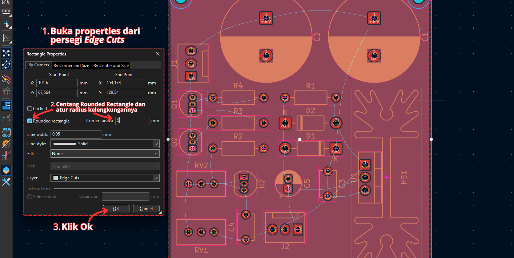

### 4.5 Penjejakan Jalur (*Track Routing*)

1. Aktifkan alat pembuat jalur dengan menekan shortcut **`X`** (*Route Single Track*).

2. Klik pada pin komponen yang memiliki petunjuk garis penanda berwarna cerah, lalu arahkan jalur hingga terhubung ke pin tujuannya.

3. **Pengaturan Lebar Track:** Tekan `E` atau pilih *Track Width Preset* pada toolbar.

* *Signal Track:* $0.25\text{ mm} - 0.4\text{ mm}$

* *Power Track ($V_{CC}/GND$):* $0.635\text{ mm} - 1.0\text{ mm}$ (Lebar jalur yang lebih besar menurunkan impedansi dan mengoptimalkan aliran arus suplai).

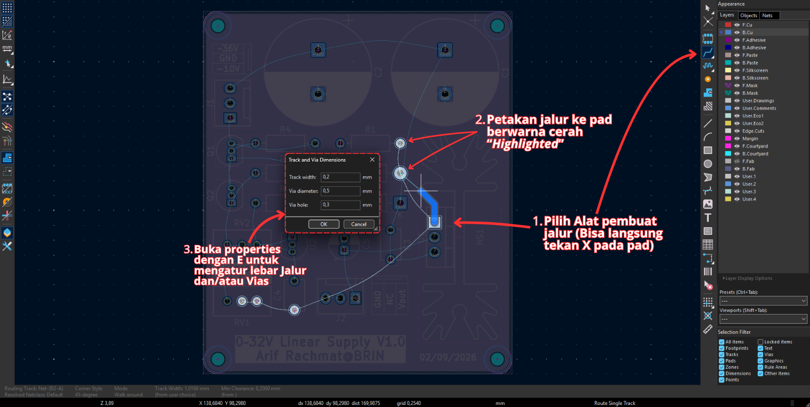

### 4.6 Verifikasi Integrasi Desain dengan Design Rules Checker (DRC)

Sebelum file dikirim ke produsen PCB (*Manufacturer*), jalankan pengujian DRC:

1. Klik ikon **Design Rules Checker** pada toolbar atas.

2. Klik tombol **Run DRC**.

3. DRC akan memeriksa jarak bebas minimum (*clearance*), jalur terputus (*unrouted nets*), dan pelanggaran *overlapping*.

4. Pastikan tidak ada peringatan fatal (*Violations*). *Warning* minor terkait komponen tertentu (seperti pin potentiometer tambahan yang mengambang) dapat dikesampingkan jika memang disengaja secara desain.

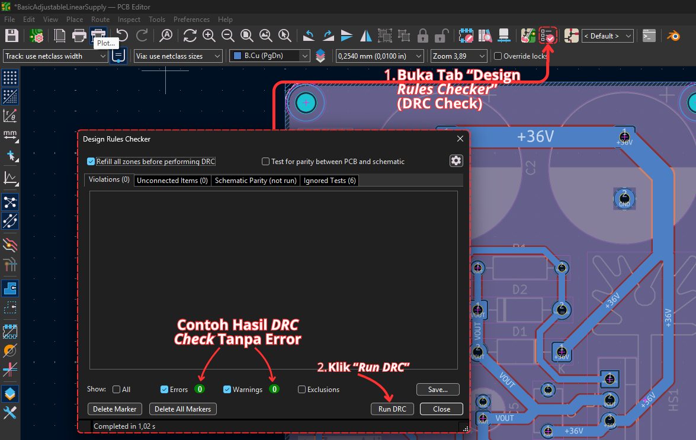

---

## 5. Kesimpulan

1. **Anotasi & ERC First:** Selalu lakukan anotasi dan jalankan ERC di modul skematik sebelum masuk ke pengerjaan PCB Editor untuk menghindari kegagalan pemetaan *footprint*.

2. **Ground Plane Optimization:** Pembuatan zona *Ground Fill* (`GND`) berguna untuk kestabilan tegangan sinyal analog/digital dan mempermudah koneksi pin GND tanpa penarikan *trace* panjang.

3. **Power Trace Sizing:** Lebarkan ukuran *track* jalur tegangan utama ($V_{CC}$) dibanding jalur sinyal biasa untuk mencegah efek penurunan tegangan (*voltage drop*) dan pemanasan pada jalur.

---

## 6. Daftar Pustaka / Referensi

1. KiCad Services Corporation. (2026). *KiCad EDA Documentation & User Manuals*. Available at: [https://docs.kicad.org/](https://www.google.com/search?q=https://docs.kicad.org/)

2. Texas Instruments. (2020). *LM393 Dual Differential Comparators Datasheet* (Rev. AB). Texas Instruments Incorporated.
3. Nexperia. (2021). *74HC02; 74HCT02 Quad 2-input NOR gate Datasheet* (Rev. 5).

---
